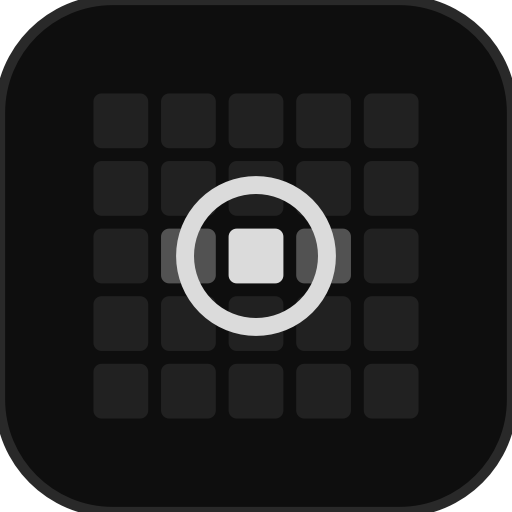
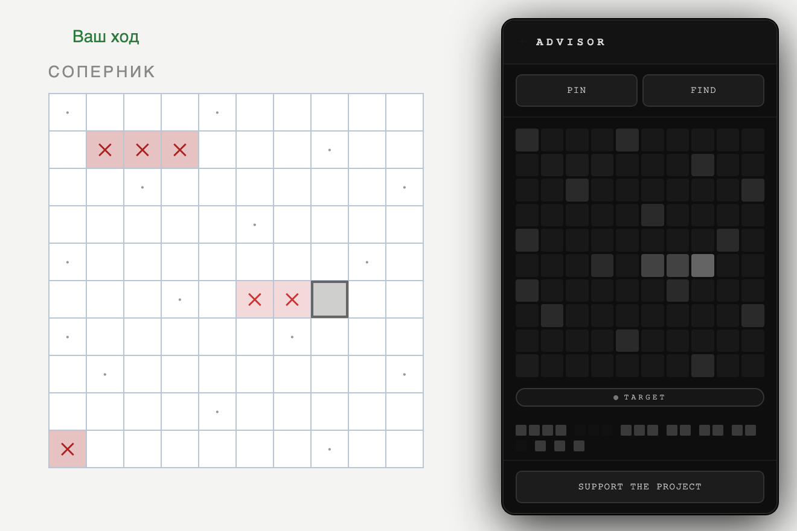

# Battleship Advisor

Подсказчик для морского боя на [battleship-game.org](https://battleship-game.org). На каждом ходу считает, в какую клетку выгоднее всего стрелять, и подсвечивает её прямо на поле соперника.

Это расширение для Chrome и других браузеров на Chromium. [Скачать zip](https://github.com/H6Whub/battleship-advisor/releases/latest/download/battleship-advisor.zip)

In English: a Chrome extension for battleship-game.org that highlights the best cell to shoot on every turn. Works with both RU (10 ships) and Classic (5 ships) rules and detects them on its own. To install, unzip it, open <code>chrome://extensions</code>, turn on Developer mode and click Load unpacked.

## Как оно выбирает клетку

Расширение перебирает все места, где ещё может стоять каждый из оставшихся кораблей, и берёт клетку, через которую проходит больше всего вариантов.

После попадания оно ищет продолжение корабля и стреляет вдоль него. Когда корабль потоплен, ходы на клетки вокруг него оно не тратит.

Когда однопалубных не осталось, оно стреляет через клетку, в шахматном порядке. Так оставшиеся корабли находятся быстрее.

Русские правила (10 кораблей) и классические (5 кораблей) расширение различает само.

## Установка

1. Скачай [`battleship-advisor.zip`](https://github.com/H6Whub/battleship-advisor/releases/latest/download/battleship-advisor.zip) и распакуй в папку.
2. Открой в браузере `chrome://extensions`.
3. Включи «Режим разработчика» справа вверху.
4. Нажми «Загрузить распакованное» и выбери эту папку.
5. Открой [battleship-game.org](https://battleship-game.org) и начни игру.

Работает в Chrome, Edge, Яндекс Браузере и других браузерах на Chromium.

## Панель

На панели видно мини-карту поля и список кораблей, которые ещё на плаву. Пока расширение добивает подбитый корабль, горит надпись TARGET.

| Кнопка | Что делает |
|---|---|
| PIN | закрепляет панель на месте |
| FIND | включает и выключает подсветку клетки на поле |
| <kbd>`</kbd> или <kbd>Esc</kbd> | прячет и показывает панель |

Панель можно перетащить за заголовок.

## Сообщение в чате

В начале каждой игры расширение один раз пишет в чат игры ссылку на этот репозиторий. Если тебе это не нужно, открой `advisor.js`, удали строку `setTimeout(sendChat,1500);` и нажми «Обновить» у расширения на странице `chrome://extensions`.

## Поддержать

Если расширение пригодилось, поддержать можно на [ko-fi.com/h6w](https://ko-fi.com/h6w) или через [DonationAlerts](https://www.donationalerts.com/r/h6wdonate).

© 2026 H6W
