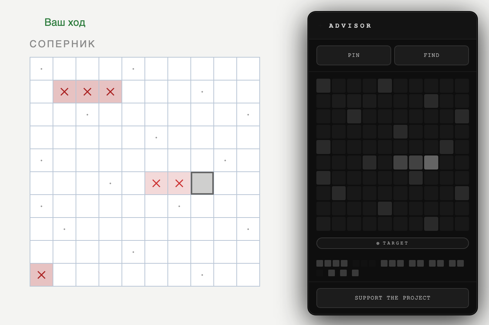

# Battleship Advisor

**Подсказчик для морского боя на [battleship-game.org](https://battleship-game.org)**

Каждый ход показывает клетку, куда выгоднее всего стрелять, и подсвечивает её прямо на поле соперника.

## Что умеет

- **Лучший выстрел.** Расширение перебирает все места, где ещё может стоять каждый из оставшихся кораблей, и выбирает клетку, через которую проходит больше всего вариантов.
- **Добивание.** После попадания оно ищет продолжение корабля и стреляет вдоль него, а после потопления не тратит ходы на клетки вокруг.
- **Шахматный поиск.** Когда однопалубных не осталось, стреляет через клетку, чтобы найти корабли быстрее.
- **Оба режима.** Русские правила (10 кораблей) и классические (5 кораблей) определяются сами.
- **Панель.** Мини-карта поля, подсказка «TARGET» во время добивания и список кораблей, которые ещё на плаву.

## Установка

1. Скачай [`battleship-advisor.zip`](https://github.com/H6Whub/battleship-advisor/releases/latest/download/battleship-advisor.zip) и распакуй в папку.
2. Открой в Chrome `chrome://extensions`.
3. Включи **«Режим разработчика»** справа вверху.
4. Нажми **«Загрузить распакованное»** и выбери папку.
5. Открой [battleship-game.org](https://battleship-game.org) и начни игру.

Работает в Chrome, Edge, Яндекс Браузере и других браузерах на Chromium.

## Управление

| | |
|---|---|
| **PIN** | закрепить панель на месте |
| **FIND** | включить или выключить подсветку клетки на поле |
| **`** или **Esc** | спрятать или показать панель |
| Заголовок панели | потянуть, чтобы передвинуть |

## Сообщение в чате

В начале каждой игры расширение один раз пишет в чат игры ссылку на этот репозиторий. Если это не нужно, открой `advisor.js` и удали строку `setTimeout(sendChat,1500);`, затем нажми «Обновить» у расширения на странице `chrome://extensions`.

## Поддержать

Если расширение пригодилось: [ko-fi.com/maixyyy](https://ko-fi.com/maixyyy)

---

© 2026 H6W

<b>English:</b> a Chrome extension for battleship-game.org that highlights the best cell to shoot every turn. It supports RU (10 ships) and Classic (5 ships) rules and detects them automatically. Install: unzip, open <code>chrome://extensions</code>, enable Developer mode, then click Load unpacked.

